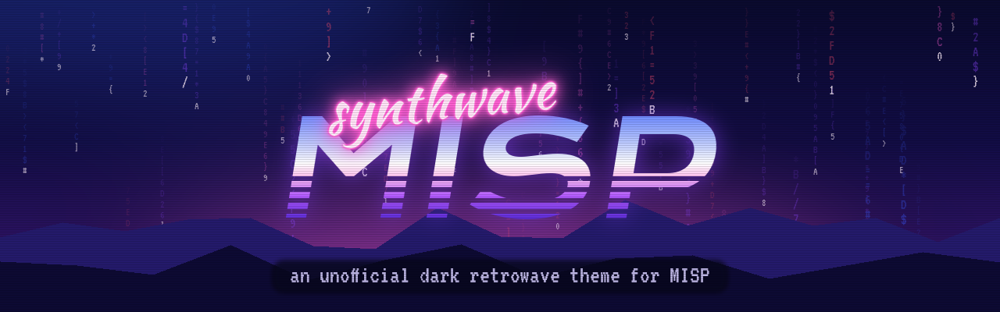
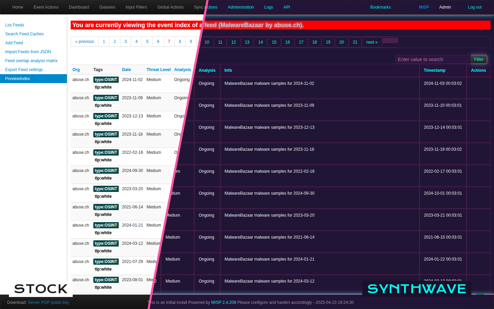

<p align="center"></p>

# MISP Synthwave Theme

An unofficial dark retrowave theme for [MISP](https://www.misp-project.org), the open-source threat intelligence sharing platform. It's one CSS file plus two optional logos. Nothing in MISP's code changes, so updates won't break it and removal is one setting.

<p align="center"></p>

## Why

MISP's default UI is bright white, and analysts on a 24/7 SOC floor stare at it through night shifts. I built this theme while running MISP in production: a dark, low-glare palette with neon accents that make tags, links, and table headers easy to pick out.

## Install

1. Copy the stylesheet into MISP's web root:
   ```bash
   sudo cp synthwave.css /var/www/MISP/app/webroot/css/
   sudo chown www-data:www-data /var/www/MISP/app/webroot/css/synthwave.css
   ```
2. In MISP, go to **Administration → Server Settings & Maintenance → MISP** and set **`MISP.custom_css`** to `synthwave.css`.
3. **Optional logos.** Copy the files in `assets/` to `/var/www/MISP/app/webroot/img/custom/`, then pick them in the logo settings on the same page: the main (top-left) logo and the footer logo.
4. Hard-refresh the browser (Ctrl+Shift+R).

To uninstall, clear `MISP.custom_css`.

## Recolour it

Every colour comes from the variables at the top of `synthwave.css`. Change them and the whole interface follows:

```css
:root {
  --background-main: #211536;
  --primary-accent:  #00fff7;  /* links, inputs, table headers */
  --secondary-accent:#ff53a1;  /* hovers, borders, highlights */
  --text-main:       #e7e7eb;
}
```

Translucent glows are derived from these variables with `color-mix()`, so they recolour too.

## Changelog

**v1.1**
- **Fixed glows that never rendered.** Rules like `box-shadow: 0 0 12px var(--primary-accent)88` tried to append hex alpha to a CSS variable. That isn't valid CSS, so browsers silently dropped those declarations (10 of them). They now use `color-mix(in srgb, var(--primary-accent) 53%, transparent)`.
- **Recolouring now covers everything.** 35 hard-coded hex colours that duplicated the palette were replaced with their variables.

## Compatibility

Tested against MISP 2.4.x / 2.5 markup. `color-mix()` needs a current browser (Chrome/Edge 111+, Firefox 113+, Safari 16.2+).

## License

[MIT](LICENSE). MISP is a trademark of the MISP project. This theme and its logos are unofficial fan work and are not affiliated with or endorsed by the MISP project.
